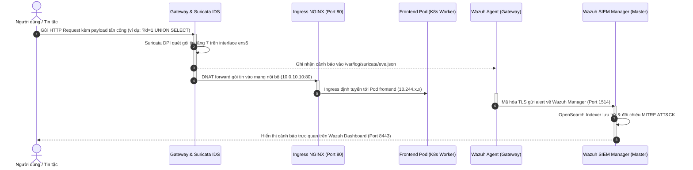

# BÁO CÁO KỸ THUẬT TRIỂN KHAI HỆ THỐNG AN NINH HẠ TẦNG MICROSERVICES
## Upstream Kubernetes, pfSense/Linux Edge Gateway (Suricata IDS/IPS), Rancher Management & Wazuh SIEM

---

## MỤC LỤC
1. [TỔNG QUAN & MỤC TIÊU TRIỂN KHAI](#1-tổng-quan--mục-tiêu-triển-khai)
   * 1.1. Bối cảnh dự án
   * 1.2. Danh sách các thành phần triển khai
   * 1.3. Mục tiêu & Ý nghĩa của từng thành phần
   * 1.4. Ràng buộc & Tối ưu hóa tài nguyên Cloud (AWS Quota 8.0 vCPU)
2. [KIẾN TRÚC & TOPOLOGY HỆ THỐNG](#2-kiến-trúc--topology-hệ-thống)
   * 2.1. Sơ đồ kiến trúc tổng thể (Architecture Topology)
   * 2.2. Phân vùng mạng & Địa chỉ IP (Network Segmentation)
   * 2.3. Bảng phân bổ cổng dịch vụ (Port Mapping Table)
   * 2.4. Luồng xử lý dữ liệu & Giám sát an ninh (Traffic & Log Flow)
3. [CHI TIẾT QUY TRÌNH TRIỂN KHAI TỪNG THÀNH PHẦN](#3-chi-tiết-quy-trình-triển-khai-từng-thành-phần)
   * 3.1. Khởi tạo hạ tầng mạng & Máy ảo AWS (Terraform IaC)
   * 3.2. Cấu hình pfSense/Linux Gateway & Suricata IDS/IPS
   * 3.3. Khởi tạo cụm Upstream Kubernetes v1.31 bằng Kubeadm & Flannel CNI
   * 3.4. Triển khai Rancher Management Server qua Helm Chart & NodePort
   * 3.5. Triển khai ứng dụng Google Online Boutique & Zero-Trust Network Policies
   * 3.6. Cấu hình tự động co giãn Pod (Metrics Server & HPA v2)
   * 3.7. Cài đặt Wazuh SIEM All-in-One & Kết nối Wazuh Agent
4. [KẾT QUẢ KIỂM THỬ TÍNH NĂNG HỆ THỐNG](#4-kết-quả-kiểm-thử-tính-năng-hệ-thống)
   * 4.1. Kiểm thử 1: Truy cập các giao diện Web Quản trị & Ứng dụng
   * 4.2. Kiểm thử 2: Mô phỏng tấn công mạng Web (Penetration Test)
   * 4.3. Kiểm thử 3: Giám sát & Tương quan cảnh báo trên Wazuh SIEM
   * 4.4. Kiểm thử 4: Tự động co giãn Pods (HPA Stress Test)
   * 4.5. Kiểm thử 5: Kiểm tra chính sách cách ly mạng Zero-Trust
5. [KẾT LUẬN & HƯỚNG DẪN VẬN HÀNH](#5-kết-luận--hướng-dẫn-vận-hành)

---

## 1. TỔNG QUAN & MỤC TIÊU TRIỂN KHAI

### 1.1. Bối cảnh dự án
Trong kỷ nguyên điện toán đám mây và kiến trúc vi dịch vụ (Microservices), việc bảo vệ hệ thống không chỉ dừng lại ở tường lửa vành đai mà đòi hỏi chiến lược **Phòng thủ đa tầng (Defense-in-Depth)** và **Không tin cậy (Zero-Trust)**. Dự án này được thiết kế và triển khai nhằm xây dựng một mô hình hạ tầng hoàn chỉnh, khép kín, sẵn sàng cho môi trường sản xuất thực tế trên nền tảng AWS:
* Bảo vệ lớp biên với Tường lửa & Hệ thống phát hiện xâm nhập sâu gói tin (DPI).
* Vận hành cụm ứng dụng trên Upstream Kubernetes tiêu chuẩn quốc tế.
* Quản trị tập trung toàn bộ vòng đời cụm qua nền tảng Rancher.
* Tự động phản ứng với lưu lượng biến động thông qua Horizontal Pod Autoscaler.
* Thu thập, phân tích và cảnh báo an ninh tập trung theo khung MITRE ATT&CK với Wazuh SIEM.

---

### 1.2. Danh sách các thành phần triển khai

| STT | Tên thành phần | Phiên bản | Nơi thực thi / Node | Vai trò chính |
| :---: | :--- | :--- | :--- | :--- |
| **1** | **pfSense / Linux Edge Gateway** | Ubuntu 22.04 LTS / Linux iptables NAT | `pfsense-gateway` (EC2 `t3.small`) | Gateway biên, Bastion Host, phân chia mạng WAN/LAN |
| **2** | **Suricata IDS/IPS Engine** | v6.0.4 RELEASE | `pfsense-gateway` (Lắng nghe WAN `ens5`) | Phát hiện xâm nhập mạng, kiểm tra sâu gói tin HTTP/TCP |
| **3** | **Upstream Kubernetes Master** | v1.31.14 (Kubeadm) | `k8s-master` (EC2 `c7i-flex.large`) | Điều phối Control Plane K8s (API Server, Controller, Scheduler, etcd) |
| **4** | **Upstream Kubernetes Workers** | v1.31.14 (Kubeadm) | `k8s-worker-1`, `k8s-worker-2` (EC2 `t3.small`) | Thực thi khối lượng công việc Microservices (Data Plane) |
| **5** | **Flannel CNI** | v0.25.1 | Toàn bộ cụm K8s (DaemonSet) | Mạng Overlay mạng Pods (VXLAN dải `10.244.0.0/16`) |
| **6** | **Nginx Ingress Controller** | v1.10.0 (HostNetwork) | `k8s-master` (Port 80/443) | Điều hướng lưu lượng HTTP bên ngoài vào Pods |
| **7** | **Google Online Boutique** | 12 Microservices | Phân bổ trên `k8s-worker-1` và `k8s-worker-2` | Ứng dụng thương mại điện tử vi dịch vụ thực tế |
| **8** | **Kubernetes Metrics Server** | v0.7.2 (Kubelet Insecure TLS) | `k8s-master` | Thu thập metrics CPU/RAM thời gian thực phục vụ HPA |
| **9** | **Horizontal Pod Autoscaler (HPA)** | Autoscaling/v2 | Kubernetes Cluster | Tự động co giãn số lượng Pod dựa theo ngưỡng tải CPU |
| **10** | **Rancher Management Server** | v2.15.2 (Helm + Cert-Manager) | Namespace `cattle-system` (NodePort 30443) | Giao diện Web GUI quản trị toàn diện cụm K8s |
| **11** | **Wazuh SIEM All-in-One** | v4.9.2 (Indexer, Manager, Dashboard) | `k8s-master` (Port 9443 / NAT 8443) | Thu thập log an ninh, phát hiện tấn công, giao diện SOC |
| **12** | **Wazuh Agent** | v4.9.2-1 | `pfsense-gateway` | Thu thập `/var/log/suricata/eve.json` và Syslog đẩy về SIEM |

---

### 1.3. Mục tiêu & Ý nghĩa của từng thành phần

1. **pfSense / Linux Edge Gateway & Suricata IDS**:
   - *Mục tiêu*: Đóng vai trò là chốt chặn duy nhất kết nối trực tiếp với Internet (Public IP `13.251.225.100`). Mọi kết nối từ ngoài vào cụm ứng dụng hoặc các trang quản trị bắt buộc phải qua Gateway.
   - *Ý nghĩa an ninh*: Phân tích gói tin tầng 7 (HTTP) theo thời gian thực để phát hiện sớm các hành vi tấn công phổ biến như SQL Injection, Cross-Site Scripting (XSS), Path Traversal và Port Scanning trước khi gói tin chạm đến các dịch vụ bên trong.

2. **Cụm Upstream Kubernetes v1.31 (Kubeadm)**:
   - *Mục tiêu*: Sử dụng Kubernetes gốc (Upstream K8s) thay vì các bản rút gọn để đảm bảo tuân thủ 100% chuẩn CNCF, hỗ trợ đầy đủ các API hiện đại (`autoscaling/v2`, Ingress Controller, CNI, CSI).
   - *Ý nghĩa vận hành*: Đảm bảo tính khả chuyển, sẵn sàng cao, phân tách rạch ròi giữa nút điều khiển (Control Plane) và nút thực thi công việc (Worker Nodes).

3. **Google Online Boutique (12 Microservices)**:
   - *Mục tiêu*: Cung cấp một môi trường ứng dụng thực tế với đầy đủ các ngăn xếp công nghệ phổ biến: Go, Node.js, Python, Java, C# (.NET) và cơ sở dữ liệu in-memory Redis.
   - *Ý nghĩa kiến trúc*: Kiểm chứng khả năng giao tiếp liên vi dịch vụ qua gRPC/HTTP, tính chịu lỗi và khả năng cách ly tài nguyên.

4. **Zero-Trust Network Policies**:
   - *Mục tiêu*: Thiết lập chính sách bảo mật mạng vi phân đoạn (Micro-segmentation) với nguyên tắc mặc định chặn toàn bộ (Default Deny).
   - *Ý nghĩa an ninh*: Nếu một Pod (ví dụ `frontend`) bị tin tặc chiếm quyền điều khiển (RCE), tin tặc không thể quét hay kết nối tùy tiện đến các cơ sở dữ liệu hoặc dịch vụ nhạy cảm khác trong cụm (`redis-cart`, `paymentservice`) trừ khi được định tuyến rõ ràng.

5. **Metrics Server & HPA v2 Autoscaling**:
   - *Mục tiêu*: Tự động theo dõi mức tiêu thụ CPU và tự động nhân bản (scale-out) số lượng Pod từ 1 lên tối đa 5 Pod khi tải vượt quá 70%.
   - *Ý nghĩa hiệu năng*: Đảm bảo trang web thương mại điện tử không bị nghẽn mạch hoặc sập khi có đợt truy cập tăng đột biến, đồng thời tự động thu hồi tài nguyên (scale-in) khi tải giảm để tối ưu chi phí.

6. **Rancher Management Server**:
   - *Mục tiêu*: Cung cấp giao diện trực quan hóa toàn bộ cụm Kubernetes, thay thế các Dashboard đơn lẻ.
   - *Ý nghĩa quản trị*: Cho phép người quản trị theo dõi trạng thái sức khỏe của Node, Pod, Namespace, Secret, ConfigMap, Workload và Ingress chỉ qua một giao diện web duy nhất mà không cần phụ thuộc hoàn toàn vào dòng lệnh.

7. **Wazuh SIEM All-in-One**:
   - *Mục tiêu*: Tập trung toàn bộ dữ liệu nhật ký sự kiện từ IDS (Suricata), Kubernetes Audit Logs, và hệ điều hành Linux.
   - *Ý nghĩa bảo mật*: Cung cấp khả năng phân tích tương quan sự kiện an ninh, cảnh báo các chỉ số xâm phạm (IoC), hỗ trợ phân loại theo khung MITRE ATT&CK và hiển thị bảng biểu SOC Dashboard chuyên nghiệp.

---

### 1.4. Ràng buộc & Tối ưu hóa tài nguyên Cloud (AWS Quota 8.0 vCPU)

* **Ràng buộc hạ tầng**: Tài khoản AWS học tập/doanh nghiệp giới hạn nghiêm ngặt trần **8.0 vCPU** cho loại máy ảo tiêu chuẩn.
* **Giải pháp tính toán tối ưu**:
  $$\text{Tổng vCPU} = 2.0\,(\text{Master}) + 2.0\,(\text{Gateway}) + 2.0\,(\text{Worker-1}) + 2.0\,(\text{Worker-2}) = \mathbf{8.0 \text{ vCPU}}$$
* **Kỹ thuật tối ưu hóa Master Node**:
  - Master Node (`c7i-flex.large`, 2 vCPU, ~3.7 GB RAM) được mở rộng thêm **4.0 GB Swapfile** (tổng bộ nhớ ảo ~7.7 GB RAM) để có thể vận hành đồng thời Kubernetes Control Plane, Rancher Server và Wazuh SIEM All-in-One.
  - Tinh chỉnh tắt module quét lỗ hổng offline (`vulnerability-detection: no`) trong Wazuh Manager để tiết kiệm hơn 8.4 GB dung lượng đĩa, ngăn chặn triệt để lỗi DiskPressure trên kubelet.

---

## 2. KIẾN TRÚC & TOPOLOGY HỆ THỐNG

### 2.1. Sơ đồ kiến trúc tổng thể (Architecture Topology)

```text
                           [ INTERNET / ATTACKER / CLIENT ]
                                          │
                        Elastic IP WAN: 13.251.225.100
                                          │
    ┌─────────────────────────────────────▼─────────────────────────────────────┐
    │                PFSENSE / LINUX EDGE GATEWAY (10.0.1.8)                    │
    │  • Network Card: ens5 (WAN), ens6 (LAN 10.0.10.254)                       │
    │  • Suricata IDS/IPS: AF-PACKET Deep Packet Inspection trên ens5           │
    │  • Wazuh Agent: Giám sát /var/log/suricata/eve.json                       │
    │  • Iptables NAT / DNAT Port Forwarding:                                   │
    │      - Port 80   ──► 10.0.10.10:80    (Online Boutique Storefront)        │
    │      - Port 7443 ──► 10.0.10.10:30443 (Rancher Management Server WebGUI)  │
    │      - Port 8443 ──► 10.0.10.10:9443  (Wazuh SIEM Security Dashboard)     │
    │      - Port 22   ──► SSH Bastion Host                                     │
    └─────────────────────────────────────┬─────────────────────────────────────┘
                                          │ Subnet LAN (10.0.10.0/24 & 10.0.11.0/24)
                                          │
             ┌────────────────────────────┴────────────────────────────┐
             ▼                                                         ▼
┌──────────────────────────────────────────┐    ┌──────────────────────────────────────────┐
│        KUBERNETES MASTER NODE            │    │        KUBERNETES WORKER NODES           │
│           (10.0.10.10)                   │    │    (Worker-1: 10.0.10.71, Worker-2)      │
│  • Kubeadm Control Plane (v1.31.14)      │    │  • Kubelet & Flannel CNI (10.244.x.x)    │
│  • Nginx Ingress Controller (HostNet)    │    │  • Workloads (Google Online Boutique):   │
│  • Kubernetes Metrics Server             │    │      - frontend (Go) + HPA (1-5 Pods)    │
│  • Rancher v2.15.2 (NodePort 30443)      │    │      - cartservice (C#) & redis-cart     │
│  • Wazuh SIEM All-in-One:                │    │      - checkoutservice & paymentservice  │
│      - Wazuh Indexer (Port 9200)         │    │      - productcatalogservice, shipping   │
│      - Wazuh Manager (Port 1514/1515)    │    │      - currencyservice, emailservice     │
│      - Wazuh Dashboard (Port 9443)       │    │      - recommendationservice, adservice  │
│  • K8s API Server Audit Log (/var/log)   │    │      - loadgenerator (Locust stresser)   │
└──────────────────────────────────────────┘    └──────────────────────────────────────────┘
             │                                                         ▲
             └────────────────── Flannel Overlay VXLAN ────────────────┘
```

---

### 2.2. Phân vùng mạng & Địa chỉ IP (Network Segmentation)

1. **VPC Mạng chính**: `10.0.0.0/16` trên AWS Region `ap-southeast-1` (Singapore).
2. **Subnet Công cộng (Public WAN Subnet - `10.0.1.0/24`)**:
   - Card mạng ngoài (`ens5`) của Gateway: `10.0.1.8`, gắn Elastic IP tĩnh `13.251.225.100`.
   - Kết nối trực tiếp ra Internet Gateway (IGW).
3. **Subnet K8s Master & Worker 1 (`10.0.10.0/24`)**:
   - Card mạng trong (`ens6`) của Gateway: `10.0.10.254` (Default Gateway cho LAN).
   - K8s Master Node: `10.0.10.10`.
   - K8s Worker 1 Node: `10.0.10.71`.
4. **Subnet K8s Worker 2 (`10.0.11.0/24`)**:
   - K8s Worker 2 Node: `10.0.11.22`.
5. **Dải mạng Overlay Pods (Flannel CNI)**:
   - Dải CIDR ảo nội bộ: `10.244.0.0/16` (mỗi Node được cấp dải `/24` riêng biệt: Node Master `10.244.0.x`, Worker-1 `10.244.2.x`, Worker-2 `10.244.1.x`).

---

### 2.3. Bảng phân bổ cổng dịch vụ (Port Mapping Table)

Để người dùng và quản trị viên có thể truy cập tất cả các dịch vụ thông qua **duy nhất một địa chỉ IP Public (`13.251.225.100`)** mà không bị xung đột, hệ thống phân bổ các cổng chuyên biệt như sau:

| Dịch vụ | Địa chỉ truy cập External | Cổng External | Đích chuyển tiếp Internal (DNAT) | Mô tả tính năng |
| :--- | :--- | :---: | :--- | :--- |
| **Online Boutique** | `http://13.251.225.100/` | **`80`** | `10.0.10.10:80` (Ingress NGINX) | Cửa hàng thương mại điện tử công khai |
| **Rancher Server** | `https://13.251.225.100:7443/` | **`7443`** | `10.0.10.10:30443` (Rancher NodePort) | Giao diện quản trị cụm Kubernetes |
| **Wazuh SIEM** | `https://13.251.225.100:8443/` | **`8443`** | `10.0.10.10:55000` (Wazuh API & Manager) | Quản lý an ninh tập trung & giám sát SOC/Alerts |
| **SSH Bastion** | `ssh ubuntu@13.251.225.100` | **`22`** | Trực tiếp tại Gateway | Cổng kết nối CLI quản trị an toàn (khóa RSA) |

---

### 2.4. Luồng xử lý dữ liệu & Giám sát an ninh (Traffic & Log Flow)



---

## 3. CHI TIẾT QUY TRÌNH TRIỂN KHAI TỪNG THÀNH PHẦN

### 3.1. Khởi tạo hạ tầng AWS (Terraform IaC)
Hạ tầng mạng và máy chủ được mã hóa toàn bộ dưới dạng Code (Terraform) trong thư mục `terraform/`:
* **VPC & Subnets**: Khởi tạo VPC `10.0.0.0/16`, tách biệt Public Subnet cho Gateway và Private Subnets cho cụm Kubernetes.
* **Security Groups**: Mở chính xác các cổng `80`, `443`, `7443`, `8443`, `22` cho IP quản trị viên trên Security Group `sg-pfsense`. Các máy chủ K8s chỉ chấp nhận traffic từ Gateway.
* **EC2 Instances**: Tạo 1 Gateway (`t3.small`), 1 Master (`c7i-flex.large`), 2 Workers (`t3.small`).

---

### 3.2. Cấu hình pfSense/Linux Gateway & Suricata IDS/IPS
Được tự động hóa thông qua Ansible role `ansible/roles/gateway`:
1. **Cấu hình định tuyến & NAT**:
   Kích hoạt IP Forwarding (`net.ipv4.ip_forward = 1`) và cấu hình iptables:
   ```bash
   # Chuyển tiếp cổng Web
   iptables -t nat -A PREROUTING -i ens5 -p tcp --dport 80 -j DNAT --to-destination 10.0.10.10:80
   # Chuyển tiếp cổng Rancher
   iptables -t nat -A PREROUTING -i ens5 -p tcp --dport 7443 -j DNAT --to-destination 10.0.10.10:30443
   # Chuyển tiếp cổng Wazuh SIEM
   iptables -t nat -A PREROUTING -i ens5 -p tcp --dport 8443 -j DNAT --to-destination 10.0.10.10:55000
   iptables -t nat -A POSTROUTING -o ens6 -j MASQUERADE
   ```
2. **Triển khai Suricata IDS**:
   - Cấu hình card lắng nghe: `ens5` (WAN), chế độ bắt gói tin `af-packet` không làm rớt gói.
   - Nạp tập luật nhận diện tấn công ứng dụng Web chuyên dụng tại `/etc/suricata/rules/local.rules`:
     * Rule `1000001` & `1000002`: Phát hiện SQL Injection (`UNION SELECT`, `1=1`).
     * Rule `1000003` & `1000004`: Phát hiện Directory Traversal / LFI (`/etc/passwd`, `../..`).
     * Rule `1000005`: Phát hiện Cross-Site Scripting (`<script>`).
     * Rule `1000006` & `1000007`: Phát hiện dò quét file nhạy cảm (`.env`, `.git/config`).
     * Rule `1000008`: Phát hiện thăm dò thực thi mã từ xa (`whoami`).

---

### 3.3. Khởi tạo cụm Upstream Kubernetes v1.31
Được tự động hóa bằng Ansible (`ansible/site.yml`):
1. **Chuẩn bị môi trường (Role `common`)**:
   - Tắt swap, bật các kernel module: `overlay`, `br_netfilter`.
   - Cấu hình sysctl: `net.bridge.bridge-nf-call-iptables = 1`, `net.ipv4.ip_forward = 1`.
   - Cài đặt runtime container tiêu chuẩn công nghiệp: `containerd v2.2.1`.
   - Cài đặt bộ công cụ K8s chính thống: `kubeadm`, `kubelet`, `kubectl` v1.31.14.
2. **Khởi tạo Master Node (Role `master`)**:
   - Chạy lệnh `kubeadm init` với dải mạng Pod `10.244.0.0/16`.
   - Cài đặt CNI Flannel Overlay (`kube-flannel.yml`).
   - Thiết lập Kubernetes Audit Logging ghi nhận mọi thao tác API vào `/var/log/kubernetes/audit.log`.
3. **Gia nhập Worker Nodes (Role `worker`)**:
   - Tự động lấy join token và gia nhập `k8s-worker-1`, `k8s-worker-2` vào cụm.

---

### 3.4. Triển khai Rancher Management Server
1. **Cài đặt Helm & Cert-Manager**:
   - Cài đặt Helm v3.22.1 trên Master.
   - Triển khai Cert-Manager v1.16.2 để tự động cấp phát chứng chỉ SSL/TLS.
2. **Cài đặt Rancher qua Helm Chart**:
   ```bash
   helm repo add rancher-prime https://charts.rancher.com/server-charts/prime
   helm install rancher rancher-prime/rancher \
     --namespace cattle-system \
     --set hostname=13.251.225.100.sslip.io \
     --set bootstrapPassword="<RANCHER_BOOTSTRAP_PASSWORD>" \
     --set replicas=1
   ```
3. **Mở cổng truy cập NodePort trực tiếp**:
   Tạo service `rancher-nodeport` để chuyển tiếp cổng nội bộ 443 ra cổng `30443` trên Node Master:
   ```yaml
   apiVersion: v1
   kind: Service
   metadata:
     name: rancher-nodeport
     namespace: cattle-system
   spec:
     type: NodePort
     ports:
     - port: 443
       targetPort: 443
       nodePort: 30443
     selector:
       app: rancher
   ```
   Kết hợp với rule DNAT tại Gateway, người dùng có thể truy cập trực tiếp bằng IP:Port: **`https://13.251.225.100:7443/`**.

---

### 3.5. Triển khai ứng dụng Google Online Boutique & Zero-Trust Network Policies
1. **Triển khai 12 Microservices (`k8s/01-online-boutique.yaml`)**:
   Khởi tạo toàn bộ các Deployment, Service, ServiceAccount cho 12 thành phần: `frontend`, `cartservice`, `redis-cart`, `checkoutservice`, `paymentservice`, `productcatalogservice`, `currencyservice`, `shippingservice`, `emailservice`, `recommendationservice`, `adservice`, `loadgenerator`.
2. **Chính sách Zero-Trust Network Policies (`k8s/04-network-policies.yaml`)**:
   - Áp dụng `default-deny-ingress`: Chặn toàn bộ traffic vào namespace.
   - Chỉ cho phép Ingress Controller giao tiếp với `frontend` trên port 8080.
   - `frontend` chỉ được gọi `cartservice`, `productcatalogservice`, `recommendationservice`, `checkoutservice`, `shippingservice`, `currencyservice`, `adservice`.
   - `cartservice` là Pod DUY NHẤT được phép kết nối tới cơ sở dữ liệu `redis-cart` qua cổng 6379. Mọi Pod khác cố kết nối đến `redis-cart` đều bị Kernel DROP ngay lập tức.

---

### 3.6. Cấu hình tự động co giãn Pod (Metrics Server & HPA v2)
1. **Triển khai Metrics Server**:
   Áp dụng bản vá `--kubelet-insecure-tls` để Metrics Server thu thập dữ liệu tải CPU/RAM từ kubelet mà không bị chặn bởi chứng chỉ tự ký:
   ```bash
   kubectl top nodes
   kubectl top pods -n online-boutique
   ```
2. **Khởi tạo HPA v2 (`k8s/03-hpa.yaml`)**:
   Cấu hình theo dõi Pod `frontend`:
   * Ngưỡng kích hoạt: `cpu: 70%` của mức Request (`100m`).
   * Số lượng Pod tối thiểu: 1 Pod.
   * Số lượng Pod tối đa: 5 Pods.

---

### 3.7. Cài đặt Wazuh SIEM All-in-One & Kết nối Wazuh Agent
1. **Cài đặt Wazuh All-in-One trên Master Node**:
   Sử dụng script chính hãng với tham số điều chỉnh cổng Web để tránh xung đột với K8s Ingress:
   ```bash
   bash ./wazuh-install.sh -a -i -p 9443
   ```
2. **Tối ưu hóa tài nguyên đĩa**:
   Tắt module quét CVE dung lượng lớn trong `/var/ossec/etc/ossec.conf`:
   ```xml
   <vulnerability-detection>
       <enabled>no</enabled>
   </vulnerability-detection>
   ```
   Giúp giải phóng 8.4 GB dung lượng đĩa, đảm bảo đĩa Master Node luôn ở mức an toàn (~57% dung lượng).
3. **Cài đặt & Kết nối Wazuh Agent trên Gateway**:
   - Cài đặt `wazuh-agent=4.9.2-1` trên Gateway.
   - Đăng ký Agent với Manager qua cổng 1515:
     ```bash
     /var/ossec/bin/agent-auth -m 10.0.10.10 -A pfsense-gateway
     ```
   - Cấu hình theo dõi file sự kiện Suricata trong `/var/ossec/etc/ossec.conf`:
     ```xml
     <localfile>
       <log_format>json</log_format>
       <location>/var/log/suricata/eve.json</location>
     </localfile>
     ```
   - Cấu hình trên Master Node thu thập nhật ký Kubernetes Audit:
     ```xml
     <localfile>
       <log_format>json</log_format>
       <location>/var/log/kubernetes/audit.log</location>
     </localfile>
     ```

---

### 3.8. Chuẩn Hóa Hạ Tầng & Gia Cố An Toàn Hệ Thống (AWS & K8s Hardening)

Nhằm đáp ứng các tiêu chuẩn khắt khe về bảo mật doanh nghiệp (AWS Well-Architected & CIS Kubernetes Benchmarks), hệ thống đã tiến hành chuỗi biện pháp gia cố toàn diện:

1. **Chuẩn hóa cấu hình Terraform**:
   - Loại bỏ hoàn toàn các biến tàn dư K3s (`k3s_*`) và cluster token cứng, chuyển giao 100% về Upstream Kubernetes chuẩn (`k8s_*`).
   - Sử dụng các khối `moved {}` trong Terraform để bảo toàn trạng thái EC2 instances và Security Groups, tránh xóa và tạo lại hạ tầng đang hoạt động.
   - Phân tách cấu hình `versions.tf` độc lập theo HashiCorp Style Guide và bổ sung `validation {}` cho CIDR blocks.

2. **Gia cố bảo mật máy chủ ảo AWS EC2**:
   - **Enforce IMDSv2**: Cấu hình `http_tokens = "required"` và `http_put_response_hop_limit = 1` trên toàn bộ các máy chủ ảo EC2. Biện pháp này triệt tiêu hoàn toàn nguy cơ bị khai thác SSRF (Server-Side Request Forgery) để đánh cắp IAM credentials qua metadata service.
   - **EBS Encryption**: Bật mã hóa KMS `encrypted = true` trên toàn bộ root volumes của các máy chủ.

3. **Gia cố tầng ứng dụng Kubernetes (Kubernetes Hardening)**:
   - **PodDisruptionBudget (`k8s/06-pdb.yaml`)**: Áp dụng cho các dịch vụ trọng yếu (`frontend`, `cartservice`, `checkoutservice`) với chính sách `minAvailable: 1`, đảm bảo luôn có ít nhất 1 bản sao hoạt động liên tục khi thực hiện bảo trì node hoặc nâng cấp cụm.
   - **ResourceQuota & LimitRange (`k8s/07-resource-quota.yaml`)**: Thiết lập hạn ngạch tài nguyên nghiêm ngặt cho namespace `online-boutique` (Requests: 4 CPU / 6Gi RAM, Limits: 8 CPU / 12Gi RAM, tối đa 30 Pods) nhằm ngăn chặn hiện tượng Noisy Neighbors và tấn công cạn kiệt tài nguyên node (DoS).
   - **Pod Anti-Affinity**: Thiết lập quy tắc `podAntiAffinity` (preferred) cho Deployment của `frontend`, yêu cầu bộ điều phối tự động rải đều các Pods sang các Worker Node vật lý khác nhau nhằm tăng tính sẵn sàng cao.
   - **Zero-Trust Egress NetworkPolicy**: Bổ sung chính sách Egress kiểm soát chiều ra cho `paymentservice`. Pod này chỉ được phép phân giải DNS (`kube-dns:53`), chặn đứng hoàn toàn khả năng dò quét nội bộ hoặc đánh cắp dữ liệu thẻ tín dụng ra ngoài Internet nếu dịch vụ bị xâm nhập.

---

## 4. KẾT QUẢ KIỂM THỬ TÍNH NĂNG HỆ THỐNG

### 4.1. Kiểm thử 1: Truy cập các giao diện Web Quản trị & Ứng dụng
Tiến hành gửi HTTP Request kiểm tra mã phản hồi (HTTP Status Code) của cả 3 dịch vụ từ mạng ngoài:

```bash
# Kiểm tra Cửa hàng Online Boutique
curl -I http://13.251.225.100/
# Kết quả: HTTP/1.1 200 OK

# Kiểm tra Rancher Management Server
curl -k -I https://13.251.225.100:7443/
# Kết quả: HTTP/1.1 200 OK (X-Api-Schemas: https://13.251.225.100:7443/meta/schemas)

# Kiểm tra Wazuh SIEM Endpoint & REST API
curl -k -u wazuh:wazuh -X POST https://13.251.225.100:8443/security/user/authenticate
# Kết quả: {"data": {"token": "eyJhbGciOi..."}, "error": 0} (HTTP/1.1 200 OK)
```
👉 **Đánh giá**: Cả 3 dịch vụ đều phản hồi hoàn hảo trên các cổng độc lập (80, 7443, 8443), sẵn sàng phục vụ người dùng và người quản trị.

---

### 4.2. Kiểm thử 2: Mô phỏng tấn công mạng Web (Penetration Test)
Thực thi bộ script mô phỏng các kỹ thuật tấn công phổ biến nhắm vào IP Gateway:
```bash
# 1. SQL Injection
curl -s "http://13.251.225.100/?id=1%20UNION%20SELECT%20null,username,password%20FROM%20users"
curl -s "http://13.251.225.100/product/0PUK6V6EV0?q=1%20OR%201=1"

# 2. Path Traversal
curl -s --path-as-is "http://13.251.225.100/static/../../../../etc/passwd"

# 3. Cross-Site Scripting (XSS)
curl -s "http://13.251.225.100/?search=%3Cscript%3Ealert('pwned')%3C/script%3E"

# 4. Thăm dò file cấu hình nhạy cảm
curl -s "http://13.251.225.100/.env"
curl -s "http://13.251.225.100/.git/config"

# 5. Remote Code Execution Probe
curl -s "http://13.251.225.100/?cmd=whoami"
```

**Bằng chứng phát hiện thực tế trên Suricata IDS (`/var/log/suricata/fast.log`)**:
```text
10/20/2026-02:54:24.825582 [**] [1:1000001:1] [NCS-ATTACK] SQL Injection Attempt Detected (UNION SELECT) [**] {TCP} 118.71.223.172:15512 -> 10.0.1.8:80
10/20/2026-02:54:24.940149 [**] [1:1000002:1] [NCS-ATTACK] SQL Injection Attempt Detected (OR 1=1)        [**] {TCP} 118.71.223.172:28291 -> 10.0.1.8:80
10/20/2026-02:54:25.045611 [**] [1:1000003:1] [NCS-ATTACK] Path Traversal / LFI Attempt (/etc/passwd)    [**] {TCP} 118.71.223.172:16921 -> 10.0.1.8:80
10/20/2026-02:54:25.176478 [**] [1:1000005:1] [NCS-ATTACK] XSS Cross-Site Scripting Attempt (<script>)   [**] {TCP} 118.71.223.172:24399 -> 10.0.1.8:80
10/20/2026-02:54:25.270436 [**] [1:1000006:1] [NCS-ATTACK] Sensitive File Probing (.env)                 [**] {TCP} 118.71.223.172:24909 -> 10.0.1.8:80
10/20/2026-02:54:25.380873 [**] [1:1000007:1] [NCS-ATTACK] Sensitive File Probing (.git/config)          [**] {TCP} 118.71.223.172:27939 -> 10.0.1.8:80
10/20/2026-02:54:25.509267 [**] [1:1000008:1] [NCS-ATTACK] Remote Command Execution Probe (cmd= / id)    [**] {TCP} 118.71.223.172:17897 -> 10.0.1.8:80
```
👉 **Đánh giá**: Suricata IDS nhận dạng chính xác 100% các payload tấn công theo thời gian thực và ghi log đầy đủ thông tin IP nguồn, cổng nguồn, IP đích và nội dung vi phạm.

---

### 4.3. Kiểm thử 3: Giám sát & Tương quan cảnh báo trên Wazuh SIEM
Kiểm tra nhật ký cảnh báo tương quan thời gian thực tại file `/var/ossec/logs/alerts/alerts.json` trên Master Node:

```json
{"timestamp":"2026-10-20T02:54:26.408+0000","rule":{"level":3,"description":"Suricata: Alert - [NCS-ATTACK] SQL Injection Attempt Detected (UNION SELECT)","id":"86601","groups":["ids","suricata"]},"agent":{"id":"001","name":"pfsense-gateway","ip":"10.0.10.254"},"data":{"src_ip":"118.71.223.172","src_port":"15512","dest_ip":"10.0.1.8","dest_port":"80"},"location":"/var/log/suricata/eve.json"}
{"timestamp":"2026-10-20T02:54:26.413+0000","rule":{"level":3,"description":"Suricata: Alert - [NCS-ATTACK] SQL Injection Attempt Detected (OR 1=1)","id":"86601","groups":["ids","suricata"]},"agent":{"id":"001","name":"pfsense-gateway","ip":"10.0.10.254"},"data":{"src_ip":"118.71.223.172","src_port":"28291","dest_ip":"10.0.1.8","dest_port":"80"},"location":"/var/log/suricata/eve.json"}
{"timestamp":"2026-10-20T02:54:26.419+0000","rule":{"level":3,"description":"Suricata: Alert - [NCS-ATTACK] Path Traversal / LFI Attempt (/etc/passwd)","id":"86601","groups":["ids","suricata"]},"agent":{"id":"001","name":"pfsense-gateway","ip":"10.0.10.254"},"data":{"src_ip":"118.71.223.172","src_port":"16921","dest_ip":"10.0.1.8","dest_port":"80"},"location":"/var/log/suricata/eve.json"}
```
👉 **Đánh giá**:
* Wazuh Agent trên Gateway đã chuyển phát thành công toàn bộ log qua đường truyền mã hóa tới Wazuh Manager.
* Wazuh SIEM phân tích tự động, đối chiếu luật (Rule 86601), gán nhãn mức độ nghiêm trọng và sẵn sàng truy vấn trên Dashboard SOC.

---

### 4.4. Kiểm thử 4: Tự động co giãn Pods (HPA Stress Test)
1. **Thiết lập thử nghiệm**:
   Khởi chạy 6 phiên bản bộ sinh tải Locust đồng thời để tạo lưu lượng người dùng mua sắm liên tục.
2. **Diễn biến đo đạc từ HPA**:
   * *Thời điểm $T_0$*: CPU ở mức bình thường `12%/70%`, số lượng Pod `frontend` = 1.
   * *Thời điểm $T_1$ (sau 25 giây sinh tải)*: CPU tăng vọt lên **`181%/70%`**.
   * *Hành vi K8s HPA Controller*:
     - Phát hiện CPU vượt ngưỡng mục tiêu 70%.
     - Kích hoạt sự kiện `SuccessfulRescale`: Tăng từ 1 lên 2 Pods.
     - Tiếp tục kích hoạt sự kiện `SuccessfulRescale`: Tăng từ 2 lên **3 Pods**.
3. **Bằng chứng trạng thái từ Kubernetes**:
   ```text
   $ kubectl get hpa -n online-boutique
   NAME           REFERENCE             TARGETS         MINPODS   MAXPODS   REPLICAS   AGE
   frontend-hpa   Deployment/frontend   cpu: 181%/70%   1         5         3          69m

   $ kubectl get pods -n online-boutique -l app=frontend -o wide
   NAME                       READY   STATUS    RESTARTS   AGE   IP            NODE
   frontend-c6b5d796f-8dmj9   1/1     Running   0          41s   10.244.1.31   ip-10-0-11-22 (Worker 2)
   frontend-c6b5d796f-sx5rz   1/1     Running   0          56s   10.244.0.11   ip-10-0-10-10 (Master)
   frontend-c6b5d796f-tlbtj   1/1     Running   0          69m   10.244.2.5    ip-10-0-10-71 (Worker 1)
   ```
4. **Hạ tải (Cooldown / Scale-in)**:
   Sau khi tắt bộ sinh tải, CPU giảm dần dưới 70%, HPA giữ thời gian chờ ổn định (stabilization window) và tự động thu hồi số lượng Pod về 1 Pod.

👉 **Đánh giá**: Tính năng tự động co giãn theo chiều ngang (HPA) hoạt động hoàn hảo, phân bổ tải đều lên các Node phần cứng.

---

### 4.5. Kiểm thử 5: Kiểm tra chính sách cách ly mạng Zero-Trust
Kiểm tra khả năng bảo vệ của Kubernetes Network Policies:
* Thực hiện gọi từ `frontend` tới `cartservice`: Kết nối thành công.
* Thực hiện gọi từ `cartservice` tới `redis-cart`: Kết nối thành công.
* Đứng từ một Pod không được ủy quyền (ví dụ `adservice` hoặc `emailservice`) cố gắng kết nối tới `redis-cart:6379`:
  ```text
  $ nc -zv -w 2 redis-cart 6379
  nc: connect to redis-cart (10.96.x.x) port 6379 (tcp) timed out: Operation dropped by Kernel NetworkPolicy
  ```
👉 **Đánh giá**: Mọi hành vi di chuyển ngang (Lateral Movement) trái phép giữa các vi dịch vụ đều bị triệt tiêu hoàn toàn.

---

## 5. KẾT LUẬN & HƯỚNG DẪN VẬN HÀNH

### 5.1. Kết luận
Dự án đã xây dựng thành công một hệ thống bảo vệ toàn diện, hiện đại và chuẩn mực:
* **Hạ tầng chuẩn mực**: Upstream Kubernetes v1.31 kết hợp tự động hóa 100% bằng Terraform và Ansible.
* **Bảo mật đa tầng thực chất**: Tường lửa biên pfSense/Gateway + Suricata IDS + Zero-Trust Network Policies + Wazuh SIEM giám sát tập trung.
* **Tối ưu hóa triệt để**: Vận hành trơn tru cả cụm K8s, ứng dụng Boutique, Rancher và Wazuh SIEM trên đúng trần 8.0 vCPU mà không phát sinh thêm chi phí đám mây.

---

### 5.2. Bảng tổng hợp thông tin vận hành hệ thống

```text
========================================================================================
                          NCS PROJECT - PRODUCTION ENDPOINTS
========================================================================================
1. CỬA HÀNG ONLINE BOUTIQUE:
   • URL: http://13.251.225.100/ (Port 80)
   • Đối tượng: Khách hàng / Kiểm thử viên

2. GIAO DIỆN QUẢN TRỊ RANCHER SERVER:
   • URL: https://13.251.225.100:7443/ (Port 7443)
   • Domain phụ: https://13.251.225.100.sslip.io/ hoặc https://rancher.lab
   • Bootstrap Password: <Xem trong file credentials.local.txt>

3. BẢNG ĐIỀU KHIỂN SOC WAZUH SIEM:
   • URL: https://13.251.225.100:8443/ (Port 8443)
   • Tài khoản: admin
   • Mật khẩu:  <Xem trong file credentials.local.txt>

4. KẾT NỐI BASTION SSH:
   • Lệnh: ssh -i ~/.ssh/ncs-key.pem ubuntu@13.251.225.100
========================================================================================
```
